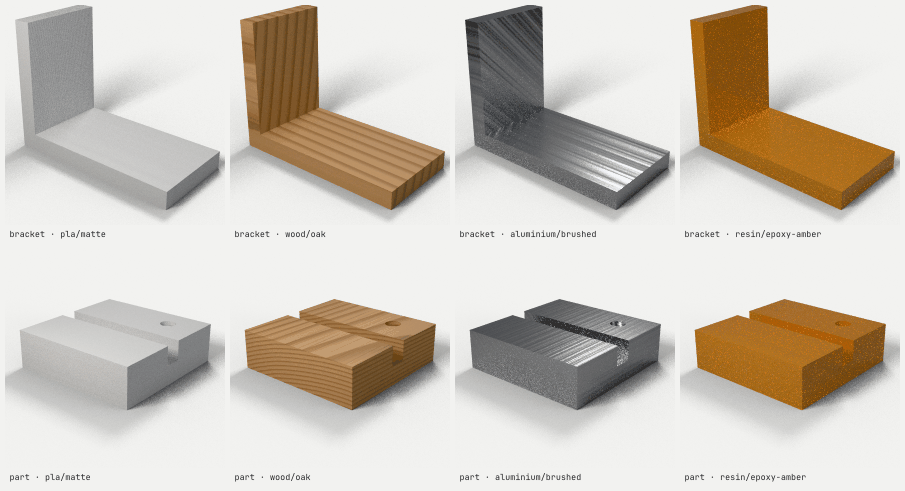

# gooey-3d

A 3D toolkit shared across projects: it generates casting moulds for 3D printing
and path-traces renders of STLs and assemblies. It is libraries plus one CLI,
`gooey-3d`, built for scripts, CI and agents. Apps expose it; this repo has no UI
and holds no project designs, only synthetic fixtures.

- **castkit** (`gooey-3d mould`): casting-mould geometry and printability checks, on
  [Manifold](https://github.com/elalish/manifold) via
  [`manifold-csg`](https://crates.io/crates/manifold-csg).
- **gooey-render** (`gooey-3d render`): a headless GPU path tracer (wgpu: Metal on
  macOS, Vulkan elsewhere) for STLs, assembly manifests and scene files.

```
crates/castkit-core   mould geometry, checker, request/response types (no file I/O)
crates/castkit-wasm   the same request/response for Node (wasm32-unknown-unknown)
crates/render         gooey-render: path tracer, scenes, manifests, finish libraries, sheets
crates/gooey-3d       the `gooey-3d` CLI: `mould build|check`, `render stl|sheet|plan|tiles|compose|scene|...`
fixtures/             synthetic parts and reports (castkit), fixtures/render (renderer)
skill/cast-moulds/    agent skill: choosing, building, checking and printing moulds
skill/render/         agent skill: ad hoc renders, contact sheets, scenes
```

## Install

- **CLI:** download `gooey-3d-vX.Y.Z-<target>.tar.gz` from a release (macOS arm64
  and x86_64, Linux x86_64), or `cargo install --git https://github.com/gooey-audio/3d gooey-3d`.
  Building needs cmake and a C++ compiler; Manifold is linked statically.
  `--no-default-features --features render` builds a render-only binary without them.
- **Node:** pin the release tarball by URL in `package.json`:
  `"castkit-wasm": "https://github.com/gooey-audio/3d/releases/download/vX.Y.Z/castkit-wasm-vX.Y.Z.tgz"`.

## Moulds

```sh
gooey-3d mould build fixtures/slab-m5-square-ears/spec.json   # STLs + report.json in the spec's `out`
gooey-3d mould build spec.json --check [--strict]             # rebuild, compare with the committed report.json
gooey-3d mould check part.stl --material pla|tpu [--bed 256]  # printability of one part
gooey-3d --version
```

A spec (paths relative to the spec file):

```json
{ "castkit": 1, "part": "part.stl", "cast": null, "method": "split",
  "material": "pla", "bolts": "M5", "square_ears": true, "nut_trap": true,
  "z_part": null, "rotate_deg": [0, 0, 0],
  "k": { "wall": 8.0, "base": 12.7 }, "out": "out/" }
```

- `method`: `split` (core + two bolted halves) or `cup`. `quadrants` and `box`
  (waveguide styles) are milestone 6 and rejected for now.
- The part is given in the casting frame after `rotate_deg`: open top at its
  lowest z, core pulls +z, seam on x = 0. castkit centres it in x and y.
- `material` is required. `k` overrides the defaults: wall 12, base 10, ear 20,
  flange 8, bolt 5.5, pocket 14, bolt_spacing 50, vent 3, vent_spacing 40, key 3,
  key_fit 0.3, segments 32, nut_af 8, nut_fit 0.3; cups use wall 6 and floor 5.
  `bolts` (`M4` or `M5`) sets bolt, pocket and nut_af together, before `k`.
- Optional: `bed` (mm, default 256), `infill` (weight estimate, default 0.4).

Output: one binary float32 STL per part in print pose (halves parting face up,
core slab down, cup cavity up) and `report.json` (`castkit-report/v1`): per part
size, pieces, genus, volume, estimated grams, STL sha256, release (undercut per
mm, overlap at 5 mm, locked, pull) and the full printability report (all twelve
checker keys); bolts, keys, holes, pour, the resolved parameters, and the castkit
and kernel versions. `gooey-3d mould build` exits 1 if any part fails a check or is
locked.

Every part also passes a postcondition before it is written: after a float32
round-trip and a slicer-style weld it is closed, one piece, with no vertex pairs
under 0.001 mm. A failure is an error, not a warning.

From Node:

```js
const ck = require("castkit-wasm");
const out = ck.build(specJson, partStlBytes, castStlBytesOrUndefined);
const report = JSON.parse(out.report_json);
for (let i = 0; i < out.len; i++) fs.writeFileSync(`${out.name(i)}.stl`, out.stl(i));
const rep = JSON.parse(ck.check(stlBytes, "pla", 256));
```

## Renders

`gooey-3d render` path-traces STLs (ad hoc) or scene files (repeatable, committed).
Logs go to stderr. `--json` prints a result record on stdout (paths, sizes, adapter,
seconds). Exit status: 0 ok, 1 stale renders (`check`) or missing tiles (`compose`), 2 error.

### Ad hoc: STLs in, PNG out

```sh
gooey-3d render stl part.stl --out part.png                          # plain grey, iso, studio
gooey-3d render stl part.stl --library lib.json --material wood/walnut --view front --out a.png
gooey-3d render stl base.stl lid.stl@'#3d5a80' --spp 512 --width 1600 --out asm.png
gooey-3d render stl part.stl --material '{"color":"#c0c4c8","metalness":1,"roughness":0.25}' \
    --env room --background transparent --out b.png
gooey-3d render sheet parts/*.stl --view iso --view top --out sheet.png        # contact sheet
gooey-3d render sheet part.stl --library lib.json \
    --material pla/matte --material wood/oak --material aluminium/brushed --out finishes.png
gooey-3d render sheet part.stl --orbit 12@20 --out turntable.png        # 12 views around +Y
gooey-3d render bounds part.stl                                       # world bounds, no GPU
```



- **STLs:** they render at their own coordinates, so several STLs from one CAD
  export make up the assembly they came from. `--up z` (the default) suits most CAD
  and slicer exports; `--up y` suits three.js/glTF-style exports.
- **Materials:** a material spec is a library finish name (`wood/walnut`), a colour
  (`#c0a080`), or JSON. In JSON, `finish`, `color` and `grain` describe the base;
  any other key is a look override (`roughness`, `metalness`, `clearcoat`,
  `clearcoat_roughness`, `transmission`, `ior`, `opacity`, `sheen`, `texture`, `figure`).
  `--material` sets the default; `part.stl@SPEC` sets one STL. In a sheet,
  `--material` and `--view` are repeatable and multiply the tiles.
- **Sheets:** one row per STL, one tile per view × material, labelled with the
  shortest unique path. Tiles are 400 px at 128 spp unless `--tile`/`--spp` say
  otherwise, and each tile is framed to its own part. `sheet.json`, next to the PNG,
  indexes every tile (rectangle, input, view, material).
- **Orbits:** `--orbit N[@DEG]` (on `sheet` and `plan`) adds N views turning around +Y,
  DEG above the horizon (default 20), starting from +X and turning toward +Z (front).
  They add to any `--view`s. A single STL's orbit is laid out as a square-ish block.
- **Labels:** `--label-from id` labels cells with tile ids (`v032-part-az030`) instead
  of names; ids are the label pieces made file-name safe.
- **Defaults:** 1200 px wide, 256 spp, `#f2f2f0` background, studio lights, iso
  view, frame cropped to the part. Any scene flag below applies.

### Sheets in pieces: plan, tiles, compose

A sheet can be planned once, rendered anywhere (in shards, on a GPU host) and
composited without a GPU. `plan` + `tiles` + `compose` give the same PNG as `sheet`
with the same flags.

```sh
gooey-3d render plan parts/*.stl --orbit 24 --out job.json               # no GPU
gooey-3d render tiles job.json --out-dir tiles/                          # all tiles
gooey-3d render tiles job.json --only part-az000,part-az015 --out-dir tiles/
gooey-3d render compose job.json --tiles tiles/ --out sheet.png          # no GPU
```

- **Job file** (`gooey-3d-job/v1`): `{schema, layout, tiles: [{id, input,
  input_sha256, view, material, up, sets, label}]}`. `layout` is the sheet grid
  (`cols`, `tile`, `gap`, `labels`, `background`, `text`). `input` is relative to the
  job file when the STL lies under its directory, else absolute; `input_sha256` is the
  STL's SHA-256. `view` is a view name or a direction; `sets` are scene `--set` pairs
  applied in order. Other tools (variant batches) can write job files directly.
- **`tiles`** checks every selected tile's STL against `input_sha256` before
  rendering (exit 2 on a mismatch) and writes `DIR/<id>.png` plus `DIR/<id>.json` (the
  `--json` record with `shot` = tile id and the tile's `input_sha256`). Material names
  need the same library as `plan` (`--library` or the project's).
- **`compose`** writes the sheet and its `sheet.json` index (cells carry their tile
  `id`). A tile without a PNG is drawn as a labelled blank cell and listed in the index
  (`missing`), on stderr and in `--json`; the exit status is then 1 unless
  `--allow-missing`. A tile whose record names a different `input_sha256` is an error.
- **Remote:** `scripts/remote-render` runs the tiles on Modal GPUs (one shard per
  STL) and composes locally; see [`modal/README.md`](modal/README.md).

### Scene flags

`--spp`, `--width`, `--aspect`, `--fov`, `--explode`, `--exposure`, `--view` (`iso`,
`front`, `side`, `top`, `rear`, `rear-iso` or `x,y,z`), `--env` (`studio`, `room`,
`file.hdr`, `env.json` or inline JSON), `--background` (`transparent` or `#rrggbb`) and
`--set KEY=VALUE` for any scene field (`camera.aperture_mm=6`, `materials.m0.clearcoat=1`;
VALUE is JSON if it parses). In STL renders the materials are `m0`, `m1`, … in
order of first use.

### Finish libraries

gooey-3d ships no finishes. A project supplies a `gooey-materials/v1` library, through
`--library` or its `gooey-3d.json`. [`fixtures/render/materials.json`](fixtures/render/materials.json)
is an example (wood, paint, aluminium, resin, PLA, fabric, room finishes);
`gooey-3d render materials --library FILE` lists one.

```json
{ "schema": "gooey-materials/v1",
  "materials": {
    "wood/walnut": { "label": "Walnut veneer / oiled", "color": "#5a3a26", "roughness": 0.75,
      "grain": { "color": "#3a2416", "period_mm": 14, "edge_color": "#7a5236", "ply_mm": 2.1 },
      "render": { "roughness": 0.6, "clearcoat": 0.35, "texture": { "kind": "wood", "scale_mm": 0.6, "strength": 0.6 },
                  "figure": { "cut": "flat", "ring_mm": 4.0, "log_mm": 140, "taper": 0.025, "contrast": 0.75 } } } } }
```

Top-level fields are the base look (`color`, `roughness`, `metalness`, `opacity`,
`grain`). `render` carries the path tracer's extras: clearcoat, transmission, sheen,
growth-ring wood `figure`, and procedural `texture` (`layers`, `brushed`, `weave`,
`fibre`, `grooves`, `wood`). A manifest material names a finish with `"finish"` and
may recolour it with its own `color`. The `room` environment's surfaces are named
finishes too: `paint/wall`, `wood/oak-floor`, `paint/satin-white`, `wood/oak-light`,
`paint/black-matte`, `fabric/wool`, `wood/walnut`, `wood/oak`, `fabric/book-cloth`,
`ceramic/glazed` and `wood/branch`. Each can be overridden in the scene.

### Assembly manifests

A manifest lists `materials` (`id`, `color`, optional `finish`, `roughness`,
`metalness`, `opacity`, `grain`), `parts` (`id`, `material`), `assets` (`id`, STL
`src` relative to the manifest) and `instances` (`id`, `part`, `asset`; `position` +
`rotation` (Euler XYZ degrees) + `scale`, or a column-major `matrix`; optional
`material`, `explode`, `groups`, `hidden`, `variants`). It may also set `up` and
`variants` (`id`, `default`, `options`). See
[`fixtures/render/assembly.json`](fixtures/render/assembly.json).
`gooey-3d render scene assembly.json --out a.png` renders one with the default scene.

### Scene files (`gooey-render/v1`)

```json
{
  "schema": "gooey-render/v1",
  "manifest": "assembly.json",
  "output": { "dir": "renders", "prefix": "hero" },
  "width": 1600, "spp": 1024, "aspect": 0.8, "background": "#202020",
  "camera": { "view": [0.5, 0.4, 1.2], "fov": 25, "padding": 0.5 },
  "environment": { "type": "room", "sideboard": {}, "rug": {}, "props": [
      { "kind": "turntable", "side": "right", "gap_mm": 140 },
      { "kind": "vase", "side": "left", "on": "floor" } ] },
  "shots": [
    { "name": "hero" },
    { "name": "front", "camera": { "view": [0, 0.12, 1] } },
    { "name": "detail", "aspect": 1, "camera": { "fit": ["D1"], "fov": 18, "padding": 0.12, "aperture_mm": 9 } }
  ]
}
```

- **Shots:** each shot is a JSON merge patch over the rest of the file (`null`
  deletes a key). The first shot writes `<prefix>.png`, the others
  `<prefix>-<name>.png`.
- **Camera:** `view` is a direction from the model to the camera or a view name.
  `fit` frames chosen part or instance ids, or `@furniture` for the room set; it
  defaults to the whole model. `aperture_mm` adds depth of field, focused on the
  framed centre unless `focus_mm` says otherwise.
- **Environment:**
  - `studio`: softboxes over a transparent shadow catcher.
  - `hdri`: `path` and an optional `sha256`.
  - `room`: laid out from the model's bounding box. A wall sits `wall_gap_mm` behind
    it, with a plank floor and skirting. A `sideboard` widens to hold the model and
    every prop on it. Props (`turntable`, `books`, `vase`, `frame`) keep their
    `side`/`gap_mm` to the model, and the render stops with an error rather than
    intersect it. A side `window` and `ambient` light it.
- **Selection:** `variants`, `explode`, `hide_groups`, `show_hidden`, `isolate`.
- **`materials.<id>`:** look overrides per manifest material, for look development.

`gooey-3d render scene scene.json --shot front --out x.png --spp 128 --set ...`
experiments without touching committed files. Overrides need `--out`.
`gooey-3d render info scene.json` prints the resolved scene, bounds and GPU adapter.

### Committed renders: projects, `sync` and `check`

A `gooey-3d.json` marks a project root:

```json
{ "schema": "gooey-3d-project/v1", "library": "framework/materials.json",
  "renders": ["*/cad/*-render.json", "framework/*/*-render.json"] }
```

`renders` globs the scene files whose shots are committed. Each of them declares
`output` (relative to the scene file). Every committed PNG gets a JSON sidecar with
the SHA-256 of everything it was made from: renderer version, shader, resolved scene
including library finishes, manifest, STLs and HDRI. `gooey-3d render check` needs no
GPU. It recomputes those hashes and fails on stale, missing or orphaned shots.
`gooey-3d render sync` re-renders just those shots and deletes the orphans.
Commands find the nearest `gooey-3d.json` above the working directory; `--project`
names one.

Renders are not bit-reproducible across GPUs, so `check` compares inputs and then
the PNG hash recorded at render time. Bump `RENDERER_VERSION`
(`crates/render/src/lib.rs`) when host-side rendering changes (framing, lights,
tonemap, geometry prep, room layout); shader edits are hashed automatically.
Either one marks every consumer's committed renders stale.

GPU: `RENDER_ADAPTER=software` forces wgpu's software fallback (lavapipe/WARP). It
works on GPU-less CI but is far slower. A 1024 spp, 1600 px shot takes about 80 s on
an M4 Pro.

## Develop

```sh
cargo test --release --workspace     # unit tests, ported reference tests, goldens, render fixture
scripts/build-wasm.sh target/pkg     # needs LLVM 20 + wasm-ld (macOS: brew install llvm@20 lld@20)
node crates/castkit-wasm/tests/node.mjs target/pkg fixtures
(cd fixtures/render && cargo run --release -p gooey-3d -- render sync)   # after renderer changes
python3 scripts/make-render-fixture.py fixtures/render   # regenerate the render fixture + expected bounds
```

`fixtures/render/` is a synthetic project: three STLs, a manifest with rotated,
mirrored, matrix-placed, exploded, hidden, grouped and variant instances, expected
world bounds computed by a separate (Python) implementation of the placement rules,
an example finish library, and a scene whose committed shots CI `check`s.

`manifold-csg` is pinned exactly (`=0.4.2`, sys `=3.5.106`) and only
`castkit_core::solid` imports it.

### Golden fixtures

`fixtures/<name>/` holds `spec.json`, the input `part.stl`, `reference/` (the
Python reference's output in print pose and its numbers, exported by a script
kept in the private waveopt repo) and `out/report.json` (castkit's own committed
report; its STLs are not committed). The golden test requires, per part, the same
piece count and genus as the reference, bounds within 1e-4 mm and a
symmetric-difference volume at most 1e-6 of the part's. It also rebuilds every
report and compares it with the committed one.

### Deliberate differences from the Python reference

Defaults give the same output.

1. Parameters are one typed struct passed everywhere (the reference's `_rod`,
   `_vents` and `_add_keys` read the global dict, ignoring `k` overrides).
2. The nut size follows the bolt spec.
3. The checker always quantises to float32 and welds before testing.
4. Post tracking is deterministic: islands sorted by area then position, and each
   post takes at most one island per layer. Checker verdicts match the reference;
   post heights can differ.
5. Section-based checks only run on meshes that are closed and one piece, and all
   inputs are validated in Rust before any kernel call (on wasm, a C++ exception
   is an unrecoverable trap).

## Status

| Milestone | State |
|---|---|
| 1. Kernel and wasm spike | Done: `manifold-csg` with `unstable-wasm-uu` works; no `Kernel` trait needed |
| 2. Goldens from the Python reference | Done: 7 synthetic fixtures, 20 parts |
| 3. `castkit-core` port (split, cup, release, poses, checker) | Done: 8 mouldkit + 2 checker cases ported, plus extras |
| 4. CLI, spec, report, `--check`, release CI | Done (section SVGs not done) |
| 5. speakers switch | Not started (in speakers) |
| 6. Waveguide styles (quadrants, box, rolled lip, threads) | Not started |
| 7. `castkit-wasm` + release tarball | Done |
| 8. waveopt switch | Not started (in waveopt; needs 6) |
| 9. Rendering | Done: path tracer moved from speakers, `gooey-3d render` (stl, sheet, scene, sync, check) |

Milestone 1 measurements (macOS arm64 host):

- Every fixture's STLs are byte-identical across native macOS arm64, macOS x86_64
  (Rosetta), `--features parallel`, and wasm32 in Node. Linux x86_64 is measured
  by CI (`--check --strict` runs as a warning step); if it agrees, `--strict`
  becomes the default.
- Against the Python reference: 17 of 20 parts have a symmetric difference of 0;
  the halves of the 57.1 and 57.15 mm boxes differ by 7e-8 of their volume,
  from rounding the input to float32.
- wasm: 914 KB (314 KB gzipped), instantiates in about 5 ms; a three-part split
  mould builds in about 100–150 ms in Node.
- The CLI links Manifold statically (only the system C++ runtime is dynamic).

## Licence

MIT OR Apache-2.0, matching `manifold-csg`.
